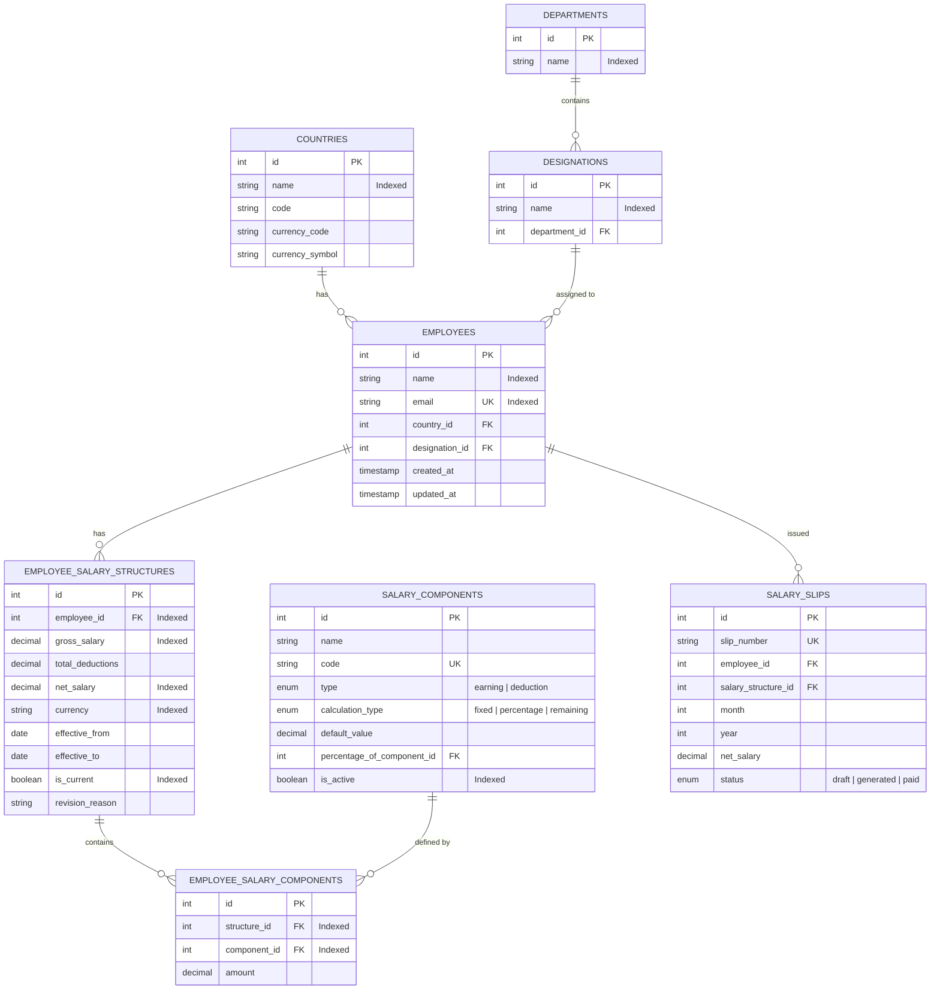

# Global Salary Management System

A full-stack, enterprise-grade web application built for **Global HR and Compensation Managers** to manage compensation structures for **10,000+ employees across multiple countries and currencies**, with dynamic itemized component breakdown, real-time math calculations, and executive analytics.

---

## 🚀 Key Features

### 1. Executive Compensation Dashboard (`/`)
* **Strict Currency Isolation:** Prevents synthetic cross-currency mixing. Toggle seamlessly between global currencies (`INR`, `USD`, `EUR`, `GBP`, `CAD`, `AUD`, `JPY`, `SGD`, `AED`, `CHF`, etc.).
* **KPI Metrics:** Instant overview of Headcount, Total Gross Payroll, Total Deductions, Net In-Hand Payroll, Average Compensation, and Pay Band Spreads.
* **Interactive Visual Analytics (Recharts):**
  * Department-wise Payroll Breakdown (Bar chart)
  * Top Earners Ranking (Bar chart)
  * Role & Job Hierarchy Distribution (Donut / Pie chart)

### 2. High-Performance Records Management (`/structures`)
* **Instant Search:** Debounced search by employee name or work email.
* **Multi-Facet Filters:** Filter by Country, Department, Designation, Currency, and Min/Max Net Salary ranges.
* **Server-Side Sorting & Pagination:** Sort dynamically on Name, Country, Department, Designation, Gross Salary, and Net Salary across page sizes (10, 25, 50, 100).
* **Audit-Ready CSV Streaming:** One-click export for selected records or **all matching records across all pages** directly from active filters.
* **Cascading Deletion:** Safe deletion with SweetAlert2 confirmation dialog.

### 3. Dedicated Salary Structure View (`/structures/:id`)
* **Employee Context Banner:** Full profile, department, designation, ID, and country badges.
* **Two-Column Itemized Breakdown:**
  * **Monthly Earnings & Allowances:** Basic Pay, House Rent Allowance (HRA), Dearness Allowance (DA), Conveyance, Medical, Special, and Bonus allowances with individual amounts and calculation rules.
  * **Monthly Deductions & Withholdings:** Provident Fund (PF), Tax Deducted at Source (TDS), Professional Tax, and Health Insurance with exact deduction rules and amounts.
* **Direct Actions:** Instant toggle to Edit mode or return to main listing.

### 4. Dynamic Add & Edit Structure Flows (`/structures/new` & `/structures/:id/edit`)
* **Active Component Generation:** Automatically fetches and renders all active salary components from the database.
* **Formula Auto-Calculation:**
  * Typing into **Basic Pay** automatically calculates **HRA (40%)**, **DA (10%)**, and **PF (12%)**.
  * Pre-populates fixed statutory defaults (Conveyance ₹1,600, Medical ₹1,250, Professional Tax ₹200, Health Insurance ₹500).
  * One-click **"Sync %"** shortcut button to restore formula-based calculation after manual edits.
  * Full support for manual line-item overrides.
* **Sticky Live Calculation Preview:**
  * Real-time Gross Pay ($\text{Basic} + \text{Allowances}$), Total Deductions, and Net Take-Home Pay.
  * Package distribution percentage breakdown (in Add mode) and **Net Pay Variance vs Previous Structure** (in Edit mode).
  * Annualized CTC projection and Annual Net credit calculation.
  * Strict validation: prevents negative Net Pay (deductions cannot exceed gross salary).

---

## 🛠️ Technology Stack

| Layer | Technology | Description |
| :--- | :--- | :--- |
| **Frontend** | React 19, Vite 8, Tailwind CSS v4 | Pure JavaScript (`.jsx`), clean UI |
| **Icons & Alerts** | Lucide React, SweetAlert2 | Polished UX |
| **Select & Charts** | React-Select, Recharts | Dropdowns with search & dynamic SVG charts |
| **Backend API** | Node.js, Express.js | Pure JavaScript RESTful API service architecture |
| **Database & ORM** | MySQL 8+, Sequelize ORM 6 | Normalized relational schema with Sequelize CLI migrations |
| **Testing** | Node.js Native Test Runner, Supertest | 16 deterministic unit and integration tests executing in ~1s |

---

## 🏛️ Database Schema Architecture

The database is fully normalized with relational integrity and indexed foreign keys:



---

## 📡 REST API Reference

| Method | Endpoint | Description |
| :--- | :--- | :--- |
| `GET` | `/api/health` | Health check endpoint returning database connectivity status |
| `GET` | `/api/structures` | Get paginated employee structures with search, sort, and filters |
| `GET` | `/api/structures/filters` | Get dropdown filter lists and active salary components |
| `GET` | `/api/structures/:id` | Get single employee details with all itemized salary components |
| `POST` | `/api/structures` | Create a new employee with salary structure and component line items |
| `PUT` | `/api/structures/:id` | Update employee salary structure and synchronize component line items |
| `DELETE`| `/api/structures/:id` | Delete employee record and cascade remove salary structures |
| `GET` | `/api/analytics/summary` | Get currency-isolated totals, headcount, and pay band spread |
| `GET` | `/api/analytics/by-department` | Get department-wise compensation breakdown |
| `GET` | `/api/analytics/by-designation`| Get designation compensation hierarchy |
| `GET` | `/api/analytics/top-earners` | Get top earners ranked by currency |
| `GET` | `/api/reports/export` | Stream audit-ready CSV based on active filter criteria or IDs |

---

## 🏁 Quickstart Guide

### 1. Prerequisites
* **Node.js** (v18.0.0 or higher)
* **MySQL** (v8.0 or higher)
* **npm** (v9 or higher)

---

### 2. Backend Setup

```bash
cd backend

# 1. Install dependencies
npm install

# 2. Configure environment file
# Create or edit backend/.env with your MySQL credentials:
PORT=5000
NODE_ENV=development
DB_HOST=localhost
DB_PORT=3306
DB_USER=root
DB_PASSWORD=your_mysql_password
DB_NAME=salary_management_db
CLIENT_URL=http://localhost:5173

# 3. Run database migrations
npm run migrate

# 4. Seed database (creates countries, departments, designations, components & 10,000 employees)
npm run seed

# 5. Run automated tests (16 tests in ~1s)
npm test

# 6. Start the development server
npm run dev
# Backend runs on http://localhost:5000
```

---

### 3. Frontend Setup

```bash
cd frontend

# 1. Install dependencies
npm install

# 2. Configure environment file
# Create or edit frontend/.env:
VITE_API_URL=http://localhost:5000

# 3. Start Vite development server
npm run dev
# Frontend runs on http://localhost:5173

# 4. Production build check
npm run build
```

---

## 📂 Project Directory Structure

```
├── backend/
│   ├── src/
│   │   ├── config/database.js          # MySQL connection and Sequelize configuration
│   │   ├── controllers/
│   │   │   ├── analyticsController.js  # Executive metrics & distribution endpoints
│   │   │   ├── reportController.js     # CSV streaming handler
│   │   │   └── salaryStructureController.js # CRUD for salary structures
│   │   ├── migrations/                 # Sequelize CLI database migrations
│   │   ├── models/                     # Sequelize models (Employee, Structure, Component, etc.)
│   │   ├── routes/
│   │   │   ├── analyticsRoutes.js      # /api/analytics routes
│   │   │   ├── reportRoutes.js         # /api/reports routes
│   │   │   └── salaryStructureRoutes.js# /api/structures routes
│   │   ├── seeders/                    # 10,000+ realistic employee seed generation
│   │   ├── services/                   # Business logic layer (Structure, Analytics, Reports)
│   │   ├── utils/calculations.js       # Gross, Net salary precision and input validation
│   │   ├── app.js                      # Express app initialization, CORS & error handling
│   │   └── server.js                   # Application entry point
│   ├── tests/                          # 16 unit and integration test suites
│   ├── .env                            # Backend environment configuration
│   └── package.json
│
├── frontend/
│   ├── src/
│   │   ├── components/                 # Reusable components (Navbar, FilterBar, Pagination, StatCard)
│   │   ├── pages/
│   │   │   ├── Dashboard.jsx           # Analytics charts & currency switcher
│   │   │   ├── SalaryStructures.jsx    # 10,000 records table with search & filters
│   │   │   ├── SalaryStructureDetail.jsx# Two-column itemized breakdown view
│   │   │   └── SalaryStructureEdit.jsx  # Add and Edit salary structure with live preview
│   │   ├── services/
│   │   │   └── api.js                  # Centralized fetch client with .env auto-normalization
│   │   ├── App.jsx                     # Layout, navigation routing & viewport control
│   │   └── index.css                   # Tailwind CSS styles
│   ├── .env                            # Frontend environment configuration (VITE_API_URL)
│   ├── .env.example                    # Frontend environment template
│   ├── vite.config.js                  # Vite configuration with dynamic API proxy
│   └── package.json
│
├── docs/
│   ├── ARCHITECTURE.md                 # System architecture and design documentation
│   └── AI_COLLABORATION_LOG.md         # Collaboration logs & benchmarks
└── README.md
```

---

## 🧪 Verification & Testing

The backend includes a comprehensive, deterministic test suite utilizing the native Node.js test runner (`node:test` and `supertest`):

```bash
cd backend
npm test
```

### Test Coverage Highlights:
* **API Endpoints:** Health checks, pagination, search, filters, validation error handling (`400 Bad Request`), and 404 handlers.
* **Calculation Engine:** Gross salary ($\text{Basic} + \text{Allowances}$), Net salary ($\text{Gross} - \text{Deductions}$), IEEE 754 two-decimal floating rounding precision, negative input rejection, and deduction cap enforcement.
* **Input Validation:** Mandatory field detection (Name, Email, Country, Department, Designation, Currency, Basic Salary).

---

